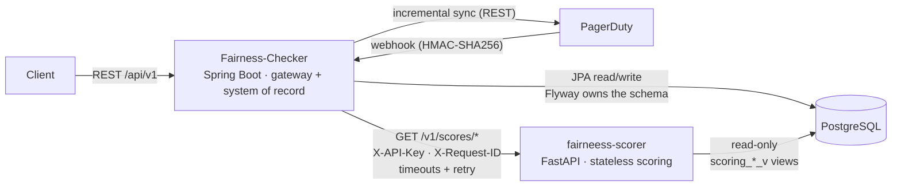
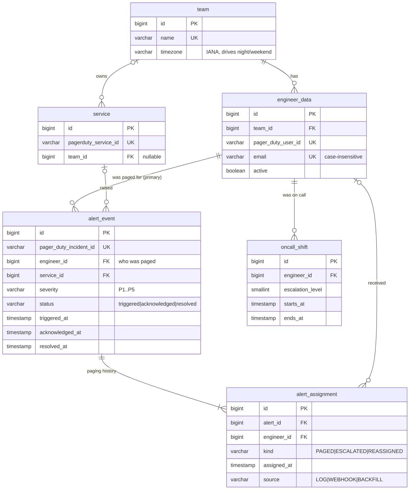

# Architecture

On-call fairness and burnout tracker for PagerDuty. Two services share one PostgreSQL database with a
strict ownership split.



## Responsibilities

| Concern | Fairness-Checker (Java) | fairneess-scorer (Python) |
|---|---|---|
| Role | Public gateway, ingestion, system of record | Internal, stateless computation |
| Database | Owns every table; the only writer | Reads two views only |
| Schema changes | Flyway migrations in `src/main/resources/db/migration`; Hibernate only validates | None |
| Exposure | Public (Azure App Service) | Private network only, API key required |

## Code layout (gateway)

Packages are organised by feature under `com.example.fairnesstracker`; each holds its controller, service,
repository, entity, `dto/` records and a MapStruct mapper (entity → response; requests are turned into
entities by the services, which own the rules). Controllers only call services:

| Package | Contents |
|---|---|
| `team`, `engineer`, `alert`, `oncall` | Core data and its REST API (`alert` also holds `MonitoredService`) |
| `pagerduty` | PagerDuty client calls, incident and on-call sync, scheduler; `webhook/` receives signed webhooks |
| `scoring` | `ScoringClient` and the `/api/v1/scores` proxy to the scorer |
| `common` | `config/` (HTTP clients, OpenAPI), `exception/` (`ApiError`, global handler), `web/` (request id filter) |
| `dev` | Helpers loaded only with the `dev` profile |

All routes are under `/api/v1`, except `/api/webhook/pagerduty`, whose URL is configured in PagerDuty.
The OpenAPI spec is served at `/v3/api-docs` and Swagger UI at `/swagger-ui.html`.

## Data model



Conventions:
- **Event times** (`triggered_at`, `starts_at`, …) are `timestamp` in **UTC**, as PagerDuty reports them. The
  API returns them as UTC instants (`"2026-09-27T18:00:00Z"`), so clients never read them as local time.
  **Audit columns** `created_at`/`updated_at` are `timestamptz`, filled by the database (default + trigger), so
  every writer gets them without application code.
- **Integrity lives in the database:** foreign keys, `CHECK` constraints for enums and time ordering, unique
  keys that make every sync idempotent. The application validates too, but the database is the last line.
- **`alert_event.engineer_id`** is the primary (first-paged) engineer, kept on the row for fast scoring;
  `alert_assignment` holds the full history, rebuilt from the PagerDuty incident log when an incident
  changes. The incident log is the source of truth; webhook rows are provisional until the next sync.
- **Engineers are deactivated, not deleted,** once they have history.

## Contracts

**Database contract: the `scoring_*_v` views** (`scoring_engineer_v`, `scoring_alert_v`,
`scoring_assignment_v`, `scoring_oncall_v`; created in V2 and extended in V3). The scorer never reads tables
directly. Tables can be refactored freely as long as the views keep their columns; views may gain columns
(appended, via `CREATE OR REPLACE VIEW`), but renaming or removing one is a breaking change and needs a
coordinated release. View timestamps are UTC unless the column name ends in `_local` (the engineer's team
timezone).

**HTTP contract: scorer `/v1/scores/*`.** Versioned in the path. Pydantic models on the scorer side and Java
records in `scoring/dto` describe the same JSON; a breaking change means a new `/v2` path, not an edit to `/v1`.
Every call carries:
- `X-API-Key`, a shared secret (`SCORER_API_KEY`), compared in constant time.
- `X-Request-ID`, generated by the gateway per incoming request and written to both services' logs, so one
  user request can be traced across services.

**HTTP contract: the gateway's lists.** Unbounded lists (alerts, engineers, on-call shifts) are paged:
`page` (from 0), `size` (default 20, capped at 100) and `sort=field,asc|desc`, answered with `PageResponse`
(`content`, `page`, `size`, `totalElements`, `totalPages`), our own type rather than Spring's `Page`, so the JSON
doesn't depend on Spring Data. Each endpoint names the fields it can sort by (anything else is a
`VALIDATION_FAILED` on `sort`) and loads a page with at most two queries (`@EntityGraph` on the list query;
`PaginationTest` counts them). Filters are optional query parameters that combine with AND; date ranges are
`start`/`end`, UTC days, both inclusive. Small, bounded lists (teams, an alert's paging history) are plain arrays.

**HTTP contract: the gateway's errors.** Every error, from any layer, is an `ApiError`: RFC 9457 problem
details served as `application/problem+json`.

```json
{"type": "about:blank", "title": "Bad Request", "status": 400,
 "detail": "email: must be a well-formed email address; name: must not be blank",
 "instance": "/api/v1/engineers", "code": "VALIDATION_FAILED",
 "errors": [{"field": "email", "message": "must be a well-formed email address"},
            {"field": "name", "message": "must not be blank"}],
 "requestId": "6f482981b48f4a09a8e64a0ddf0a866f", "timestamp": "2026-10-12T16:39:45.614Z"}
```

- Clients branch on `code` (`ErrorCode`), never on `detail`, which is for people and may change.
- `errors` names the offending body fields or query/path parameters, so a form can show each message
  next to its input; it is empty when the problem isn't about one field.
- `requestId` equals the `X-Request-ID` response header and appears in the logs of both services.
- Server errors (`INTERNAL_ERROR`) never include exception messages, hosts or SQL.

| Code | Status | When |
|---|---|---|
| `VALIDATION_FAILED` | 400 | Bean validation, unparseable values, unknown references (e.g. a team name) |
| `MALFORMED_REQUEST` | 400 | Missing body or broken JSON |
| `BAD_REQUEST` | 400 (or other 4xx) | Any other client error |
| `NOT_FOUND` | 404 | The resource in the URL, or the route, doesn't exist |
| `METHOD_NOT_ALLOWED` / `NOT_ACCEPTABLE` / `UNSUPPORTED_MEDIA_TYPE` | 405 / 406 / 415 | Protocol errors |
| `CONFLICT` | 409 | Duplicates (with the field) and operations the current state forbids |
| `UPSTREAM_ERROR` / `UPSTREAM_UNAVAILABLE` / `UPSTREAM_TIMEOUT` | 502 / 503 / 504 | Scorer or PagerDuty failed |
| `INTERNAL_ERROR` | 500 | A bug; quote the `requestId` |

Exceptions map onto this in `common/exception`: services throw `ValidationException`,
`ConflictException` or `ResourceNotFoundException` (all `ApiException`s carrying an `ErrorCode`);
`GlobalExceptionHandler` converts those and Spring's own exceptions; `ApiErrorController` covers errors that
never reach a controller.

## Data flow

1. **Ingestion.** PagerDuty pushes webhooks (verified with HMAC-SHA256). A scheduled sync pulls incidents
   created in the last `PAGERDUTY_SYNC_LOOKBACK_DAYS` days as a safety net for missed webhooks, upserting by
   PagerDuty incident id (unique index).
2. **On-call shifts.** The same scheduled job reads PagerDuty `/oncalls` (in ≤ 90-day chunks) into
   `oncall_shift`, merging overlapping pieces of one shift.
3. **Attribution.** An alert belongs to the engineer who was **paged**: the first assignee, falling back to
   the incident's first assignment log entry. It is set once on creation and never overwritten by later
   updates, so resolving someone else's incident doesn't move the alert to you.
   The incident log (read when an incident is new or changes status) rebuilds the alert's paging history
   (`alert_assignment`: paged, escalated, reassigned) and sets `acknowledged_at`.
4. **Scoring.** The gateway forwards score requests to the scorer, which loads the window from the views
   (cached for 60 s), computes scores in pandas and returns typed JSON. Scoring rules are in
   `fairneess-scorer/docs/SCORING.md`.

## Reliability

| Failure | Behaviour |
|---|---|
| Scorer slow | Connect timeout 2 s, response timeout 10 s → gateway returns 504 |
| Scorer down / 5xx | GET retried twice with exponential backoff (200 ms base) → then 503 |
| Scorer 4xx | Passed through (e.g. 404 unknown engineer), never retried |
| PagerDuty slow | Same timeouts on the PagerDuty client; a failed sync is logged and retried next cycle |
| Database down | Scorer readiness (`/health`) and gateway readiness (`/actuator/health/readiness`) fail; compose / the platform stops routing traffic |

## Security

- Secrets only come from the environment (`.env` locally, App Service settings in Azure); `.env` files are
  git-ignored and excluded from Docker images.
- Scorer: API key on all `/v1` routes; health and metrics are unauthenticated and must stay on the private
  network. Error responses never include database details.
- Database: the scorer should log in as a read-only role limited to the two views
  (`ops/sql/create_scorer_readonly_role.sql`).
- Webhooks: HMAC-SHA256 with constant-time comparison.
- Gateway: every route needs an access token except `/`, `/error`, health/info/prometheus, the PagerDuty
  webhook, `POST /api/v1/auth/{login,refresh,logout}` and the API docs. Security errors are `ApiError`s
  like any other (401 `UNAUTHENTICATED`, 403 `FORBIDDEN`, ...).
- Tokens: the gateway issues its own. Access token: HS256 JWT (`sub` = user id, `email`, `role`), 15 minutes,
  kept in memory by the client. Refresh token: opaque, single-use, rotated on every refresh, stored as a
  SHA-256 hash, sent as an httpOnly `SameSite=Strict` cookie limited to `/api/v1/auth`; reusing a rotated
  one ends that sign-in everywhere. No sessions, so no CSRF tokens. An access token can't be revoked: a
  disabled user or changed password takes effect when it expires (refresh is refused at once).
- Sign-in: BCrypt (cost 12); 5 wrong passwords lock the account for 15 minutes; 10 attempts per minute per
  client IP (in memory, per instance). There's no sign-up; the first admin comes from `ADMIN_BOOTSTRAP_*`
  and must change the password before anything else.
- Access (`AccessPolicy`): roles are checked with `@PreAuthorize`, data with the user's scope, read from the
  database on each request so changes apply at once:

  | | ADMIN | MANAGER | ENGINEER |
  |---|---|---|---|
  | Alerts, engineers, on-call shifts | all | their teams' | their own |
  | Fairness and time-of-day scores | all teams | their teams | own team, only their own row |
  | Burnout list; one engineer's scores | all | their teams | no; only their own |
  | Change engineers, alerts; edit a team | yes | in their teams | no |
  | Create/delete teams, delete alerts, PagerDuty operations | yes | no | no |

  Lists are filtered rather than refused; a single record outside the scope is a 403.

## Observability

| | Gateway | Scorer |
|---|---|---|
| Logs | Structured JSON (`LOGGING_STRUCTURED_FORMAT_CONSOLE=ecs`) with `requestId` | JSON (`LOG_FORMAT=json`) with `request_id`, method, path, status, duration |
| Metrics | `/actuator/prometheus` | `/metrics` |
| Health | `/actuator/health/liveness`, `/actuator/health/readiness` | `/health/live`, `/health` |

## Delivery

- **CI:** each repo runs its own workflow on pull requests and pushes to `main`. Java: `mvn verify`, including
  a Testcontainers test that applies every Flyway migration to a real PostgreSQL and validates the JPA mapping,
  then an image build. Python: ruff, mypy, unit tests and integration tests against a PostgreSQL service
  container, then an image build.
- **CD:** switched off for now, so merges don't deploy anything. To bring back the Azure deploy, restore
  `.github/workflows/main_fairness-tracker.yml` from git history (commit `7a7316f^`); Flyway then runs pending
  migrations when the deployed app starts.
- **Local (Docker):** each repo has its own `docker-compose.yml` and runs independently. They share the external
  Docker network `fairness-net` (`docker network create fairness-net`, once per machine), where the gateway
  reaches the scorer at `http://scorer:8000`. Neither compose file runs a database: both connect to the
  existing PostgreSQL from their `.env`. The scorer port is bound to `127.0.0.1` only.

## Configuration

New settings introduced with this architecture (existing database and PagerDuty settings are unchanged):

| Variable | Service | Required | Default | Purpose |
|---|---|---|---|---|
| `SCORER_API_KEY` | both | **yes** (≥ 32 chars, same value on both) | none | Gateway → scorer authentication |
| `JWT_SECRET` | gateway | **yes** (≥ 32 chars) | none | Signs access tokens (HS256); changing it signs everyone out |
| `JWT_ISSUER` / `JWT_AUDIENCE` / `JWT_ACCESS_TOKEN_TTL` | gateway | no | `fairness-checker` / `fairness-web` / `15m` | Access token claims and lifetime (1 minute to 1 hour) |
| `REFRESH_TOKEN_TTL` / `REFRESH_TOKEN_REUSE_GRACE` | gateway | no | `7d` / `10s` | Session length without use; how soon after a refresh the old token may be presented again (two tabs) before it counts as theft and ends the session |
| `ADMIN_BOOTSTRAP_EMAIL` / `ADMIN_BOOTSTRAP_PASSWORD` / `ADMIN_BOOTSTRAP_NAME` | gateway | both or neither (password ≥ 12 chars) | none / none / `Administrator` | First admin, created while there are no users; must change the password at first sign-in |
| `LOGIN_MAX_FAILED_ATTEMPTS` / `LOGIN_LOCK_DURATION` / `LOGIN_ATTEMPTS_PER_IP_PER_MINUTE` | gateway | no | `5` / `15m` / `10` | Account lockout and per-IP sign-in limit |
| `REFRESH_COOKIE_SECURE` | gateway | no | `true` | Set `false` only for plain HTTP on a host other than localhost |
| `FORWARD_HEADERS_STRATEGY` | gateway | no | `native` | Trust `X-Forwarded-*` from private-network proxies (client IP for rate limits) |
| `PYTHON_SCORER_URL` | gateway | in Azure | `http://127.0.0.1:8000` | Where the scorer runs |
| `SCORER_CONNECT_TIMEOUT` / `SCORER_RESPONSE_TIMEOUT` / `SCORER_MAX_RETRIES` | gateway | no | `2s` / `10s` / `2` | Scorer call resilience |
| `PAGERDUTY_CONNECT_TIMEOUT` / `PAGERDUTY_RESPONSE_TIMEOUT` | gateway | no | `5s` / `30s` | PagerDuty call timeouts |
| `PAGERDUTY_SYNC_ENABLED` / `PAGERDUTY_SYNC_LOOKBACK_DAYS` | gateway | no | `true` / `30` | Scheduled incident sync |
| `PAGERDUTY_ONCALL_LOOKBACK_DAYS` | gateway | no | `7` | Scheduled on-call sync; backfill with `POST /api/v1/pagerduty/sync/oncalls?days=365` |
| `SEED_DEMO_DATA` | gateway | no | `false` | Demo engineers in an empty database |
| `JPA_SHOW_SQL` | gateway | no | `false` | Log SQL (debugging only) |
| `LOGGING_STRUCTURED_FORMAT_CONSOLE` | gateway | no | plain text | `ecs` for JSON logs |
| `API_DOCS_ENABLED` | gateway | no | `true` | Serve the OpenAPI spec (`/v3/api-docs`) and Swagger UI (`/swagger-ui.html`) |
| `TEAM_TIMEZONE` | gateway | no | `Asia/Kolkata` | How analytics dates are read; set it to the scorer's value so both cover the same hours |
| `TEAM_TIMEZONE` / `CACHE_TTL_SECONDS` | scorer | no | `Asia/Kolkata` / `60` | Timezone for `start`/`end` dates (night/weekend use each team's own timezone); result cache |
| `LOG_FORMAT` / `LOG_LEVEL` | scorer | no | `text` (`json` in Docker) / `INFO` | Logging |

## Known limitations

- Single gateway instance assumed: the scheduled sync has no distributed lock (add ShedLock before scaling out), and
  the sign-in rate limit is counted per instance.
- The scorer loads the full window into memory; fine up to ~10⁵ alerts per window. Beyond that, move
  aggregation into SQL.
